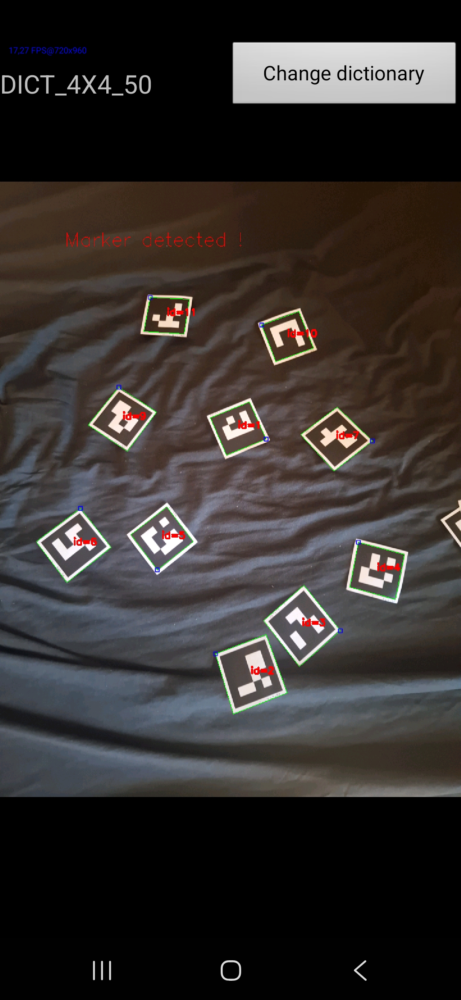
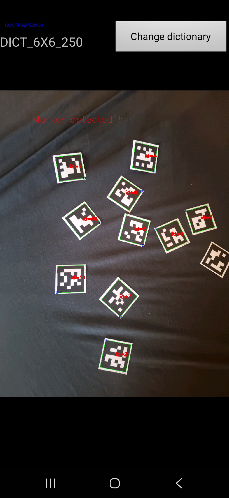

# ArUco-Markers-Identifier

An Android application for identifying and detecting ArUco markers using OpenCV.





## Build instruction

First, add the OpenCV SDK 4.14 at the root of the project :

```
├── ArUco-Markers-Identifier
|   ├─ src
|   └─...
└──sdk
    ├─ etc
    ├─ java
    ├─ libcxx_helper
    ├─ native
    └─ build.gradle

```

Then set your JAVA_HOME to JDK 17.0.20.1

Then build the APK with the following command :
```bash
gradlew assembleDebug
```

And finally, get the apk from "ArUco-Markers-Identifier/build/outputs/apk/debug". And install it to your device.

## Acknowledgments & Credit

This project is based on and inspired by the official Android samples from the **[OpenCV (Open Source Computer Vision Library)](https://opencv.org/)** repository. 

- **OpenCV Website:** [https://opencv.org](https://opencv.org)
- **OpenCV Android Platform Guide:** [http://opencv.org/platforms/android](http://opencv.org/platforms/android)

## License

This project is licensed under the **Apache License 2.0** - see the [LICENSE](LICENSE) file for details. 

Original OpenCV components and samples are subject to their respective copyright and licensing terms under the Apache License 2.0.
